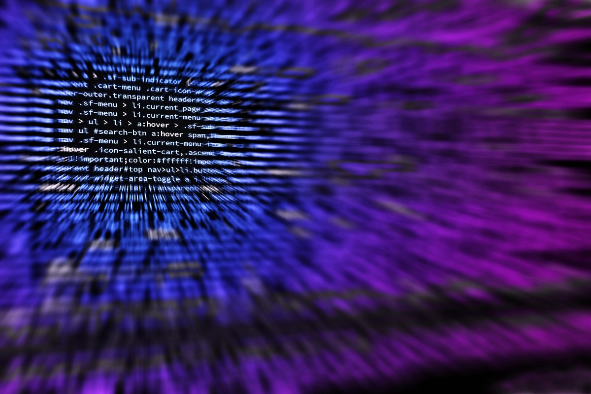

# SceneShift

**Author:** Sai Nath ([@sainathkunduru](https://github.com/sainathkunduru))

A real-time video background replacement tool using deep learning-based semantic segmentation. Replace your webcam background with any image or video of your choice — perfect for video calls, streaming, and creative applications.

## Features

- **Live webcam background replacement** with multiple background options
- **Mobile live streaming** support via IP Webcam
- **Server-based processing** with Flask web interface
- **Android client app** for mobile video upload
- **Multiple visual effects** — background swap, black & white, cartoon, crayon
- **DeepLab V3** semantic segmentation model
- **Real-time performance** with OpenCV

## Technologies

- TensorFlow (DeepLab V3 MobileNet V2)
- OpenCV
- Flask
- Android (Java)

## Results

| Input | Background | Output |
|:-----:|:----------:|:------:|
|  |  |  |

## Quick Start

```bash
git clone https://github.com/sainathkunduru/SceneShift.git
cd SceneShift
```

### 1. Live Webcam Mode

```bash
cd "Live Webcam Front"
pip install -r requirements.txt  # if available
python live_webcam.py
```

Press and hold `a`, `b`, or `c` to switch between backgrounds.

### 2. Server Mode (Flask)

```bash
cd "Server Front"
pip install flask opencv-python tensorflow
FLASK_APP=index.py flask run
```

Open `http://localhost:5000`, upload a video and background image, and download the processed result.

### 3. IP Webcam Streaming

```bash
cd "Live Stream Output"
# Edit IP_Webcam_Out.py with your mobile device's IP address
python IP_Webcam_Out.py
```

### 4. Android App

Open the `Android-Front` directory in Android Studio and build the APK.

## Project Structure

```
├── Live Webcam Front/          # Live webcam with background switching
├── Live Stream Output/         # Mobile IP webcam streaming
├── Server Front/               # Flask-based web interface
├── Android-Front/              # Android client app
└── images/                     # Sample images
```

## License

MIT License

## Contact

**Sai Nath** — [sainathreddykunduru@gmail.com](mailto:sainathreddykunduru@gmail.com)
